# Relatório de Bugs - Calculadora Científica

- **Arquivo analisado:** `Calculadora.py`
- **Ambiente:** Windows, Python 3.14.3, numpy 2.4.6, VS Code
- **Data de identificação:** 06/11/2026
- **Método:** leitura do código e execução manual com `python Calculadora.py`

## Resumo

| ID | Título | Severidade | Status |
|---|---|---|---|
| BUG-01 | Adição devolve 2x + y | Alta | Resolvido |
| BUG-02 | Divisão por zero não tratada | Alta | Resolvido |
| BUG-03 | Fatorial sempre devolve 0 | Alta | Resolvido |
| BUG-04 | Fatorial sem validação de número negativo | Média | Resolvido |
| BUG-05 | Logaritmo natural usa função inexistente `np.ln` | Alta | Resolvido |
| BUG-06 | Logaritmo base 10 usa `np.log` | Alta | Resolvido |
| BUG-07 | Logaritmo base 10 aceita o valor 0 | Média | Resolvido |
| BUG-08 | Seno listado no menu, mas não implementado | Média | Resolvido |
| BUG-09 | Cosseno chama função inexistente | Alta | Resolvido |
| BUG-10 | Tangente chama função inexistente | Alta | Resolvido |
| BUG-11 | Menu executa ao importar o arquivo | Média | Resolvido |

---

## BUG-01 - Adição devolve 2x + y

- **Localização:** `Calculadora.py`, função `adicao`, linha 4 (`return x + np.add(x, y)`)
- **Descrição:** a função soma `x` com o resultado de `np.add(x, y)`, que já é `x + y`. O resultado final é `2x + y`. Afeta toda adição feita na calculadora.
- **Contexto:** Python 3.14.3, numpy 2.4.6, Windows.
- **Passos para reproduzir:**
  1. Rodar `python Calculadora.py`
  2. Digitar `1` (Adição)
  3. Primeiro número: `2`; segundo número: `3`
- **Consistência:** ocorre sempre.
- **Resultado esperado:** `5.0`
- **Resultado obtido:** `7.0`
- **Evidência:** 
- **Severidade:** Alta
- **Impacto:** a operação mais básica devolve resultado errado.
- **Possível solução:** `return x + y`
- **Status:** Resolvido em 07/11/2026

## BUG-02 - Divisão por zero não tratada

- **Localização:** `Calculadora.py`, função `divisao`, linha 13 (`return x / y`)
- **Descrição:** não há verificação de `y == 0`. O programa lança exceção e encerra.
- **Contexto:** Python 3.14.3, Windows.
- **Passos para reproduzir:**
  1. Rodar `python Calculadora.py`
  2. Digitar `4` (Divisão)
  3. Primeiro número: `10`; segundo número: `0`
- **Consistência:** ocorre sempre.
- **Resultado esperado:** mensagem de erro informando que não é possível dividir por zero, sem encerrar o programa.
- **Resultado obtido:** `ZeroDivisionError: division by zero` e o programa fecha.
- **Evidência:** 
- **Log de erro:** `ZeroDivisionError: division by zero` (linha 13, em `divisao`)
- **Severidade:** Alta
- **Impacto:** o usuário perde a sessão por uma entrada comum.
- **Possível solução:** retornar mensagem de erro quando `y == 0`, como já é feito na raiz quadrada.
- **Status:** Resolvido em 07/11/2026

## BUG-03 - Fatorial sempre devolve 0

- **Localização:** `Calculadora.py`, função `fatorial`, linha 25 (`for i in range(x+1)`)
- **Descrição:** `range(x+1)` começa em 0, então o primeiro `fat *= i` multiplica por 0 e o resultado fica sempre 0.
- **Contexto:** Python 3.14.3, Windows.
- **Passos para reproduzir:**
  1. Rodar `python Calculadora.py`
  2. Digitar `7` (Fatorial)
  3. Número: `5`
- **Consistência:** ocorre sempre.
- **Resultado esperado:** `120`
- **Resultado obtido:** `0`
- **Evidência:** 
- **Severidade:** Alta
- **Impacto:** a operação nunca devolve resultado correto.
- **Possível solução:** `range(1, x+1)`
- **Status:** Resolvido em 07/11/2026

## BUG-04 - Fatorial sem validação de número negativo

- **Localização:** `Calculadora.py`, função `fatorial`, linhas 23 a 27
- **Descrição:** a função não valida a entrada. Para números negativos, o laço não executa e a função devolve 1, mas o fatorial de número negativo não existe.
- **Contexto:** Python 3.14.3, Windows.
- **Passos para reproduzir:**
  1. Rodar `python Calculadora.py`
  2. Digitar `7` (Fatorial)
  3. Número: `-3`
- **Consistência:** ocorre sempre.
- **Resultado esperado:** mensagem de erro informando que o fatorial não é definido para negativos.
- **Resultado obtido:** `Resultado: 1`
- **Evidência:** 
- **Severidade:** Média
- **Impacto:** resultado matemático incorreto, sem aviso ao usuário.
- **Possível solução:** retornar mensagem de erro quando `x < 0`.
- **Status:** Resolvido em 07/11/2026

## BUG-05 - Logaritmo natural usa função inexistente

- **Localização:** `Calculadora.py`, função `logaritmo_natural`, linha 32 (`return np.ln(x)`)
- **Descrição:** o numpy não possui `np.ln`. A função correta é `np.log`.
- **Contexto:** Python 3.14.3, numpy 2.4.6.
- **Passos para reproduzir:**
  1. Rodar `python Calculadora.py`
  2. Digitar `8` (Logaritmo Natural)
  3. Número: `10`
- **Consistência:** ocorre sempre para números positivos.
- **Resultado esperado:** aproximadamente `2.302585`
- **Resultado obtido:** o programa fecha com erro.
- **Evidência:** 
- **Log de erro:** `AttributeError: module 'numpy' has no attribute 'ln'`
- **Severidade:** Alta
- **Impacto:** a operação não funciona para nenhuma entrada válida.
- **Possível solução:** `return np.log(x)`
- **Status:** Resolvido em 07/11/2026

## BUG-06 - Logaritmo base 10 usa a função errada

- **Localização:** `Calculadora.py`, função `logaritmo_base10`, linha 37 (`return np.log(x)`)
- **Descrição:** `np.log` calcula o logaritmo natural, não o de base 10.
- **Contexto:** Python 3.14.3, numpy 2.4.6.
- **Passos para reproduzir:**
  1. Rodar `python Calculadora.py`
  2. Digitar `9` (Logaritmo Base 10)
  3. Número: `100`
- **Consistência:** ocorre sempre.
- **Resultado esperado:** `2.0`
- **Resultado obtido:** `4.605170185988092`
- **Evidência:** 
- **Severidade:** Alta
- **Impacto:** a operação devolve valor incorreto para todas as entradas.
- **Possível solução:** `return np.log10(x)`
- **Status:** Resolvido em 07/11/2026

## BUG-07 - Logaritmo base 10 aceita o valor 0

- **Localização:** `Calculadora.py`, função `logaritmo_base10`, linha 35 (`if x < 0:`)
- **Descrição:** a validação usa `x < 0`, mas o logaritmo só é definido para números positivos. O valor 0 passa pela validação. A mensagem de erro diz "não positivo", o que mostra a intenção de bloquear 0 também. O logaritmo natural usa corretamente `x <= 0`.
- **Contexto:** Python 3.14.3, numpy 2.4.6.
- **Passos para reproduzir:**
  1. Rodar `python Calculadora.py`
  2. Digitar `9` (Logaritmo Base 10)
  3. Número: `0`
- **Consistência:** ocorre sempre.
- **Resultado esperado:** `Erro: Logaritmo de número não positivo`
- **Resultado obtido:** `Resultado: -inf`, com `RuntimeWarning: divide by zero encountered in log`
- **Evidência:** 
- **Severidade:** Média
- **Impacto:** valor matemático inválido exibido como resultado.
- **Possível solução:** trocar a condição para `x <= 0`.
- **Status:** Resolvido em 07/11/2026

## BUG-08 - Seno listado no menu, mas não implementado

- **Localização:** `Calculadora.py`, função `menu` (opção 10) e função `calculadora_cientifica`
- **Descrição:** o menu oferece "10. Seno", mas não existe função de seno nem tratamento da opção 10.
- **Contexto:** Python 3.14.3, Windows.
- **Passos para reproduzir:**
  1. Rodar `python Calculadora.py`
  2. Digitar `10`
- **Consistência:** ocorre sempre.
- **Resultado esperado:** pedir o ângulo e mostrar o seno.
- **Resultado obtido:** `Operação inválida. Tente novamente.`
- **Evidência:** 
- **Severidade:** Média
- **Impacto:** funcionalidade anunciada ao usuário não existe.
- **Possível solução:** implementar a função `seno` e adicionar a opção `10` ao fluxo.
- **Status:** Resolvido em 07/11/2026

## BUG-09 - Cosseno chama função inexistente

- **Localização:** `Calculadora.py`, função `calculadora_cientifica`, linha 95 (`cosseno(x)`)
- **Descrição:** a função `cosseno` não está definida em nenhum lugar do arquivo. O VS Code também sinaliza o problema (Pylance: `reportUndefinedVariable`).
- **Contexto:** Python 3.14.3, Windows.
- **Passos para reproduzir:**
  1. Rodar `python Calculadora.py`
  2. Digitar `11` (Cosseno)
  3. Ângulo: `60`
- **Consistência:** ocorre sempre.
- **Resultado esperado:** aproximadamente `0.5`
- **Resultado obtido:** o programa fecha com erro.
- **Evidência:** 
- **Log de erro:** `NameError: name 'cosseno' is not defined`
- **Severidade:** Alta
- **Impacto:** a operação está no menu, mas derruba o programa.
- **Possível solução:** implementar `cosseno` convertendo graus para radianos (`np.cos(np.radians(x))`).
- **Status:** Resolvido em 07/11/2026

## BUG-10 - Tangente chama função inexistente

- **Localização:** `Calculadora.py`, função `calculadora_cientifica`, linha 99 (`tangente(x, radianos=False)`)
- **Descrição:** a função `tangente` não está definida. A chamada ainda usa o parâmetro `radianos=False`, que também não existe em lugar nenhum. O VS Code sinaliza o problema.
- **Contexto:** Python 3.14.3, Windows.
- **Passos para reproduzir:**
  1. Rodar `python Calculadora.py`
  2. Digitar `12` (Tangente)
  3. Ângulo: `45`
- **Consistência:** ocorre sempre.
- **Resultado esperado:** aproximadamente `1.0`
- **Resultado obtido:** o programa fecha com erro.
- **Evidência:** 
- **Log de erro:** `NameError: name 'tangente' is not defined`
- **Severidade:** Alta
- **Impacto:** a operação está no menu, mas derruba o programa.
- **Possível solução:** implementar `tangente` com o parâmetro `radianos` ou ajustar a chamada.
- **Status:** Resolvido em 07/11/2026

## BUG-11 - Menu executa ao importar o arquivo

- **Localização:** `Calculadora.py`, última linha (108): `calculadora_cientifica()`
- **Descrição:** a chamada fica no nível do módulo, sem `if __name__ == "__main__":`. Ao importar o arquivo (por exemplo, em um teste automatizado), o menu abre e espera entrada do teclado.
- **Contexto:** Python 3.14.3; afeta o uso do pytest.
- **Passos para reproduzir:**
  1. Em um terminal, rodar `python -c "import Calculadora"`
- **Consistência:** ocorre sempre.
- **Resultado esperado:** apenas carregar as funções, sem executar o menu.
- **Resultado obtido:** o menu aparece e o programa aguarda digitação.
- **Evidência:** observação direta no código (linha 108).
- **Severidade:** Média
- **Impacto:** impede testar as funções de forma automatizada.
- **Possível solução:** proteger com `if __name__ == "__main__":`.
- **Status:** Resolvido em 06/11/2026 (corrigido como pré-requisito para os testes automatizados)

---

## Correção do BUG-03 com TDD

- **Bug corrigido:** BUG-03 - Fatorial sempre devolve 0
- **Data:** 07/11/2026
- **O que foi alterado:** na função `fatorial`, o laço `for i in range(x+1)` passou a ser `for i in range(1, x+1)`.
- **Por que foi alterado:** o laço começava em 0, então `fat *= 0` zerava o resultado em toda chamada. Começando em 1, o produto é calculado corretamente.
- **Como isso resolve o bug:** `fatorial(5)` passa a devolver `120`, em vez de `0`.

### Preparação

Antes dos testes, o BUG-11 foi corrigido: a chamada `calculadora_cientifica()` foi protegida com `if __name__ == "__main__":`, para que o pytest consiga importar o arquivo sem abrir o menu. Commit: `refactor: protege execucao do menu com __main__`.

### Ciclo TDD

1. **Red:** foi escrito o teste `test_fatorial_de_5` (`assert fatorial(5) == 120`), que falhou com `assert 0 == 120`. Commit: `test: adiciona teste que falha para BUG-03 (fatorial)`.

   

2. **Green:** correção mínima no laço (`range(1, x+1)`). O teste passou. Commit: `fix: corrige fatorial para iniciar o laco em 1 (BUG-03)`.

   

3. **Refactor:** adição de docstring à função `fatorial`, sem alterar o comportamento. Commit: `refactor: adiciona docstring ao fatorial`.

### Verificação final

Foram adicionados testes de regressão (`fatorial(0)`, `fatorial(1)`, subtração, multiplicação e raiz quadrada, com valor válido e negativo). Todos os 7 testes passam, então a correção não introduziu novos bugs. Commit: `test: adiciona testes de regressao para fatorial, subtracao, multiplicacao e raiz`.

---

## Correção dos demais bugs com TDD (Sprint 2)

Depois da entrega inicial, os demais bugs também foram corrigidos, um de cada vez, seguindo o mesmo ciclo: **Red** (teste que falha, com commit), **Green** (correção mínima, com commit e push só quando todos os testes passam) e, quando havia o que melhorar, **Refactor**. Nas correções abaixo de uma ou duas linhas, não houve refatoração necessária. Data: 07/11/2026.

### BUG-01 - Adição

- **O que foi alterado:** na função `adicao`, `return x + np.add(x, y)` passou a ser `return x + y`.
- **Por que foi alterado:** o `x` era somado duas vezes (uma direto e outra dentro de `np.add`).
- **Como isso resolve o bug:** `adicao(2, 3)` passa a devolver `5`, em vez de `7`.
- **Red:** teste `test_adicao` (`assert adicao(2, 3) == 5`) falhou com `assert 7 == 5`. Commit: `test: adiciona teste que falha para BUG-01 (adicao)`.

  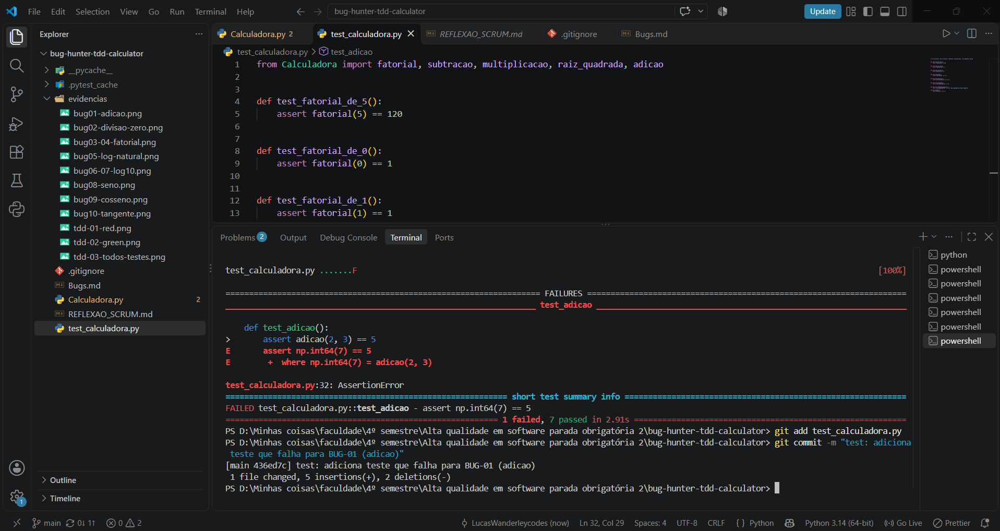

- **Green:** com a correção, todos os 8 testes passaram.

  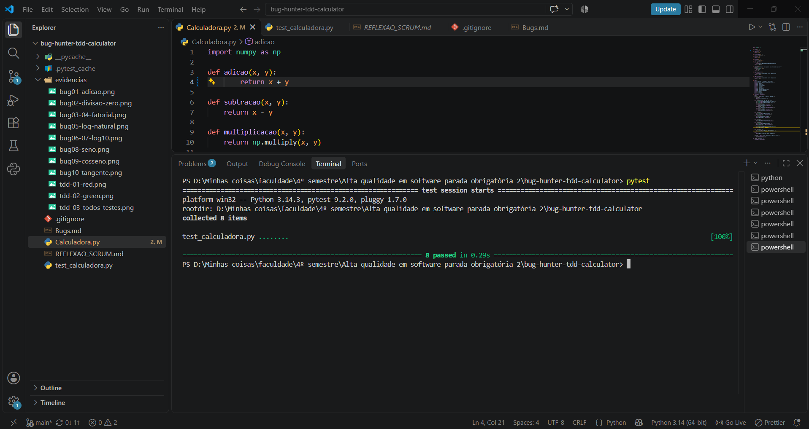

### BUG-02 - Divisão por zero

- **O que foi alterado:** na função `divisao`, foi adicionada a verificação `if y == 0:` antes do cálculo, devolvendo `"Erro: Divisão por zero"`.
- **Por que foi alterado:** a divisão por zero lançava `ZeroDivisionError` e fechava o programa.
- **Como isso resolve o bug:** `divisao(10, 0)` passa a devolver a mensagem de erro e o programa continua funcionando.
- **Red:** testes `test_divisao` (`divisao(10, 2) == 5`) e `test_divisao_por_zero` (`divisao(10, 0) == "Erro: Divisão por zero"`). O segundo falhou com `ZeroDivisionError`. Commit: `test: adiciona testes para BUG-02 (divisao por zero)`.

  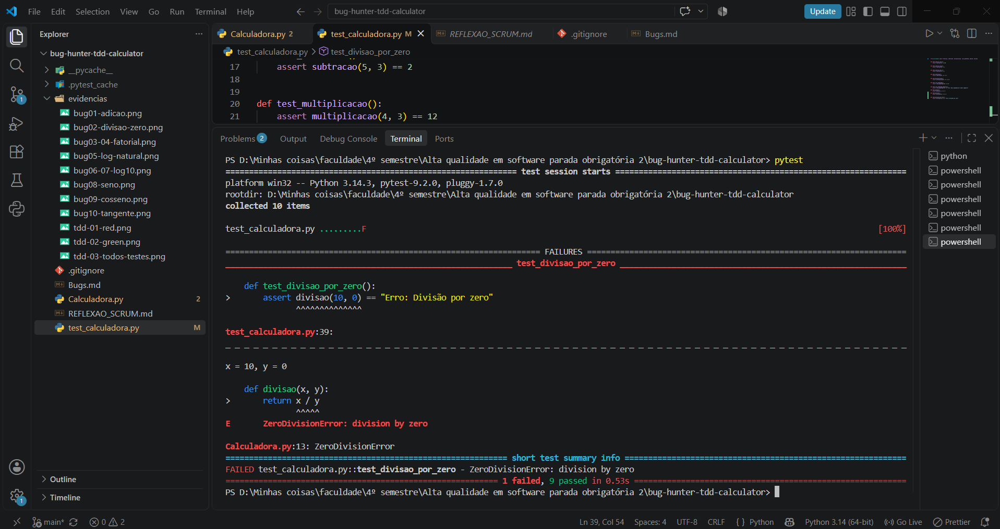

- **Green:** os 10 testes passaram. Commit: `fix: trata divisao por zero (BUG-02)`.

  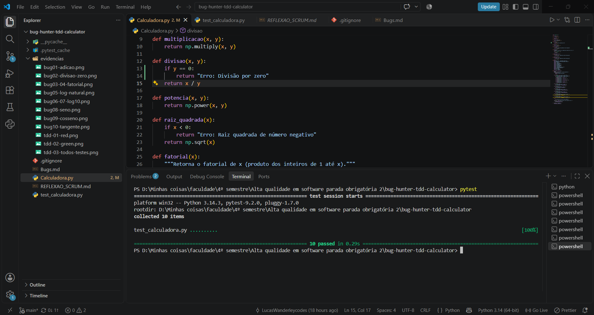

### BUG-05 - Logaritmo natural

- **O que foi alterado:** na função `logaritmo_natural`, `np.ln(x)` passou a ser `np.log(x)`.
- **Por que foi alterado:** o numpy não possui `np.ln`; o logaritmo natural é `np.log`.
- **Como isso resolve o bug:** `logaritmo_natural(10)` passa a devolver aproximadamente `2.302585`, sem erro.
- **Red:** testes `test_logaritmo_natural` e `test_logaritmo_natural_nao_positivo` (este protege a validação que já funcionava). O primeiro falhou com `AttributeError: module 'numpy' has no attribute 'ln'`. Commit: `test: adiciona testes para BUG-05 (logaritmo natural)`.

  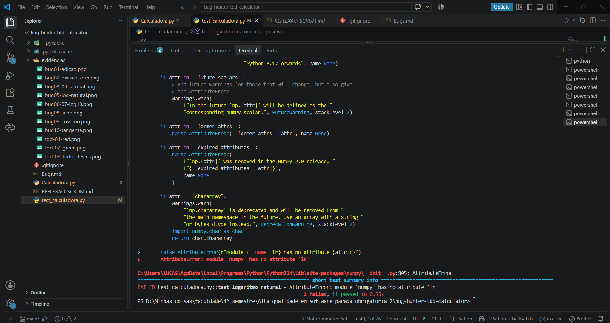

- **Green:** os 12 testes passaram. Commit: `fix: usa np.log no logaritmo natural (BUG-05)`.

  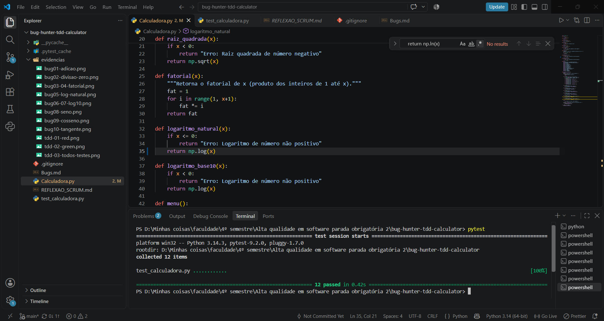

### BUG-06 e BUG-07 - Logaritmo base 10

Os dois bugs estão na mesma função (`logaritmo_base10`) e foram corrigidos juntos, cada um com seu próprio teste.

- **O que foi alterado:** `np.log(x)` passou a ser `np.log10(x)` (BUG-06) e a condição `if x < 0:` passou a ser `if x <= 0:` (BUG-07).
- **Por que foi alterado:** `np.log` calcula o logaritmo natural, não o de base 10; e o valor 0 passava pela validação, devolvendo `-inf`.
- **Como isso resolve os bugs:** `logaritmo_base10(100)` passa a devolver `2.0` e `logaritmo_base10(0)` devolve a mensagem de erro.
- **Red:** testes `test_logaritmo_base10` (falhou com `4.605... - 2.0`) e `test_logaritmo_base10_zero` (falhou com `-inf`). Commit: `test: adiciona testes para BUG-06 e BUG-07 (log base 10)`.

  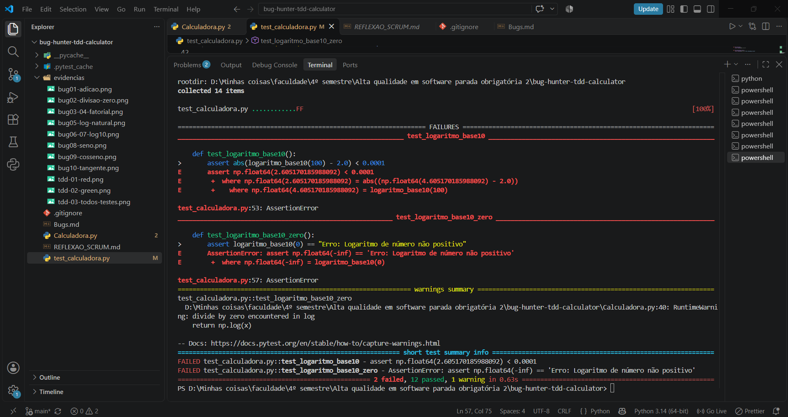

- **Green:** os 14 testes passaram. Commit: `fix: corrige log base 10 e validacao de zero (BUG-06 e BUG-07)`.

  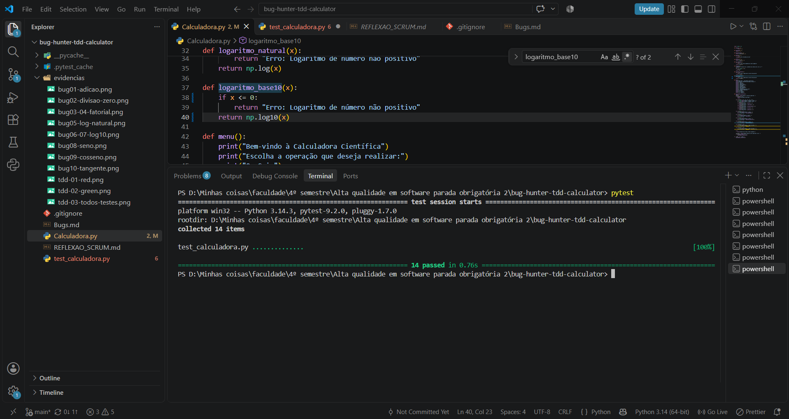

### BUG-04 - Fatorial de número negativo

- **O que foi alterado:** na função `fatorial`, foi adicionado `if x < 0: return "Erro: Fatorial de número negativo"` antes do laço.
- **Por que foi alterado:** o fatorial de número negativo não existe, mas a função devolvia `1` sem avisar.
- **Como isso resolve o bug:** `fatorial(-3)` passa a devolver a mensagem de erro.
- **Red:** teste `test_fatorial_negativo` falhou com `assert 1 == 'Erro: Fatorial de número negativo'`. Commit: `test: adiciona teste para BUG-04 (fatorial negativo)`.

  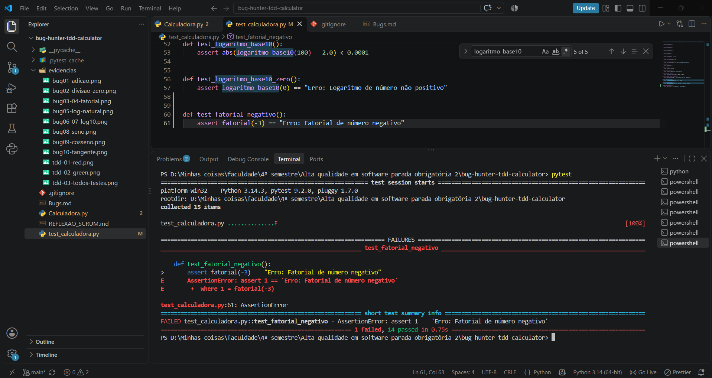

- **Green:** os 15 testes passaram. Commit: `fix: valida fatorial de numero negativo (BUG-04)`.

  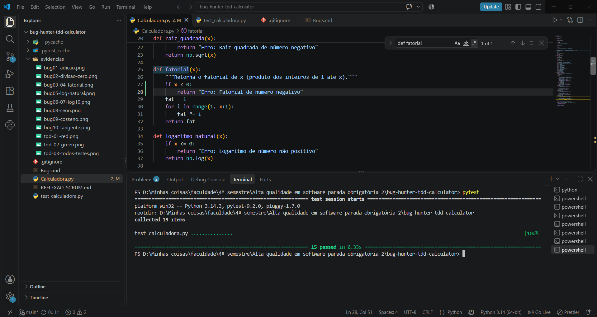

### BUG-09 e BUG-10 - Cosseno e tangente

- **O que foi alterado:** foram criadas as funções `cosseno(x, radianos=False)` e `tangente(x, radianos=False)`. Quando `radianos` é `False`, o ângulo em graus é convertido com `np.radians` antes de calcular `np.cos` ou `np.tan`.
- **Por que foi alterado:** o menu chamava funções que não existiam, e o programa fechava com `NameError`. O parâmetro `radianos` manteve o formato com que o menu já chamava as funções.
- **Como isso resolve os bugs:** `cosseno(60)` devolve aproximadamente `0.5` e `tangente(45)` devolve aproximadamente `1.0`.
- **Red:** testes `test_cosseno_de_60_graus` e `test_tangente_de_45_graus`. O pytest nem conseguiu importar as funções (`ImportError: cannot import name 'cosseno'`), o que conta como Red. Commit: `test: adiciona testes para BUG-09 e BUG-10 (cosseno e tangente)`.

  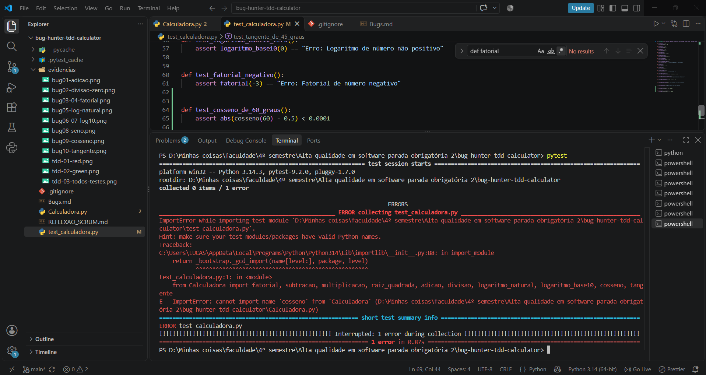

- **Green:** os 17 testes passaram. Commit: `fix: implementa cosseno e tangente (BUG-09 e BUG-10)`.

  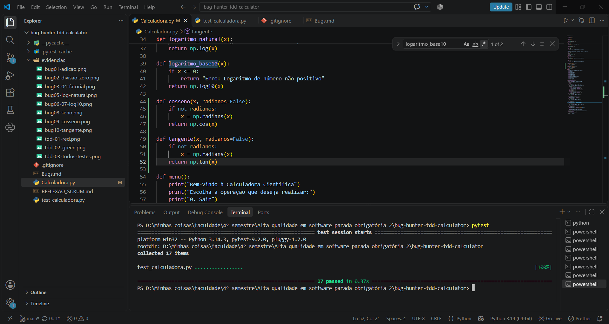

### BUG-08 - Seno

- **O que foi alterado:** foi criada a função `seno(x, radianos=False)` (mesmo padrão do cosseno) e foi adicionado o bloco `elif escolha == '10':` em `calculadora_cientifica`, pedindo o ângulo em graus e mostrando o resultado.
- **Por que foi alterado:** o menu anunciava "10. Seno", mas não existia a função nem o tratamento da opção, que caía em "Operação inválida".
- **Como isso resolve o bug:** `seno(30)` devolve aproximadamente `0.5`, e a opção 10 do menu passa a funcionar.
- **Red:** teste `test_seno_de_30_graus` falhou com `ImportError: cannot import name 'seno'`. Commit: `test: adiciona teste para BUG-08 (seno)`.

  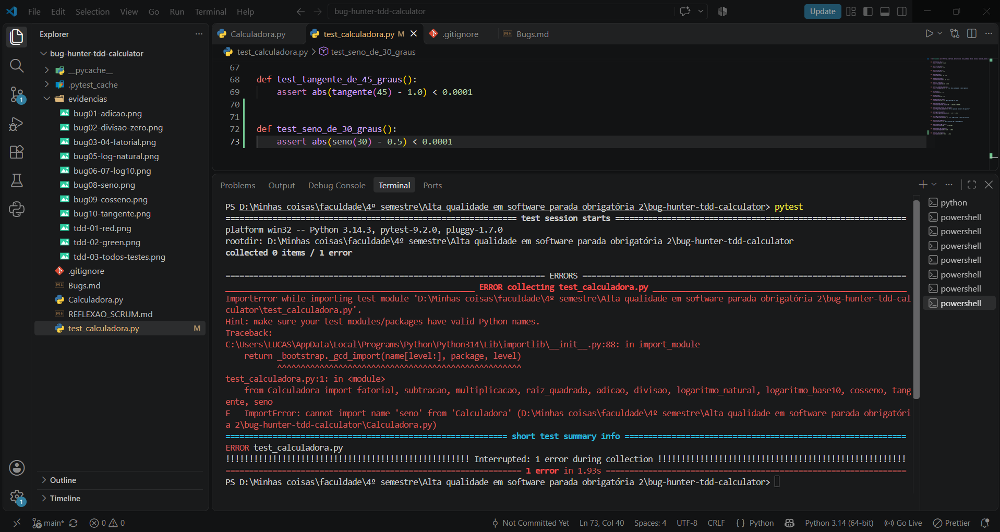

- **Green:** com a função `seno`, os 18 testes passaram. Commit: `fix: implementa seno (BUG-08)`.

  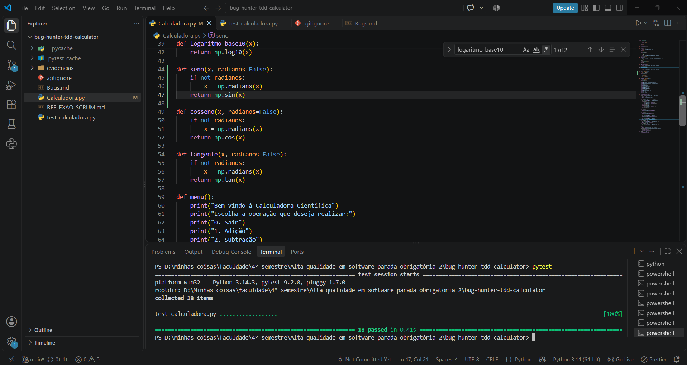

- **Menu:** como o menu depende de `input`, essa parte foi verificada manualmente: opção `10`, ângulo `30`, resultado `0.49999999999999994` (aproximadamente `0.5`, por arredondamento do computador). Commit: `fix: liga opcao 10 do menu ao seno (BUG-08)`.

  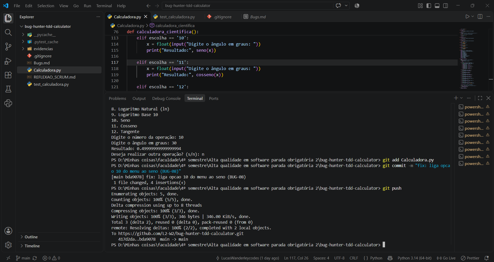

### Verificação final

Os 18 testes automatizados passam, então as correções não introduziram novos bugs nas funções que já funcionavam (subtração, multiplicação, raiz quadrada e fatorial seguiram passando em todas as rodadas). Os 11 bugs relatados estão resolvidos.