# Relatório de Bugs - Calculadora Científica

- **Arquivo analisado:** `Calculadora.py`
- **Ambiente:** Windows, Python 3.14.3, numpy 2.4.6, VS Code
- **Data de identificação:** 06/11/2026
- **Método:** leitura do código e execução manual com `python Calculadora.py`

## Resumo

| ID | Título | Severidade | Status |
|---|---|---|---|
| BUG-01 | Adição devolve 2x + y | Alta | Não resolvido |
| BUG-02 | Divisão por zero não tratada | Alta | Não resolvido |
| BUG-03 | Fatorial sempre devolve 0 | Alta | Resolvido |
| BUG-04 | Fatorial sem validação de número negativo | Média | Não resolvido |
| BUG-05 | Logaritmo natural usa função inexistente `np.ln` | Alta | Não resolvido |
| BUG-06 | Logaritmo base 10 usa `np.log` | Alta | Não resolvido |
| BUG-07 | Logaritmo base 10 aceita o valor 0 | Média | Não resolvido |
| BUG-08 | Seno listado no menu, mas não implementado | Média | Não resolvido |
| BUG-09 | Cosseno chama função inexistente | Alta | Não resolvido |
| BUG-10 | Tangente chama função inexistente | Alta | Não resolvido |
| BUG-11 | Menu executa ao importar o arquivo | Média | Resolvido |

---

## BUG-01 - Adição devolve 2x + y

- **Localização:** `Calculadora.py`, função `adicao`, linha 4 (`return x + np.add(x, y)`)
- **Descrição:** a função soma `x` com o resultado de `np.add(x, y)`, que já é `x + y`. O resultado final é `2x + y`. Afeta toda adição feita na calculadora.
- **Contexto:** Python 3.14.3, numpy 2.4.6, Windows.
- **Passos para reproduzir:**
  1. Rodar `python Calculadora.py`
  2. Digitar `1` (Adição)
  3. Primeiro número: `2`; segundo número: `3`
- **Consistência:** ocorre sempre.
- **Resultado esperado:** `5.0`
- **Resultado obtido:** `7.0`
- **Evidência:** 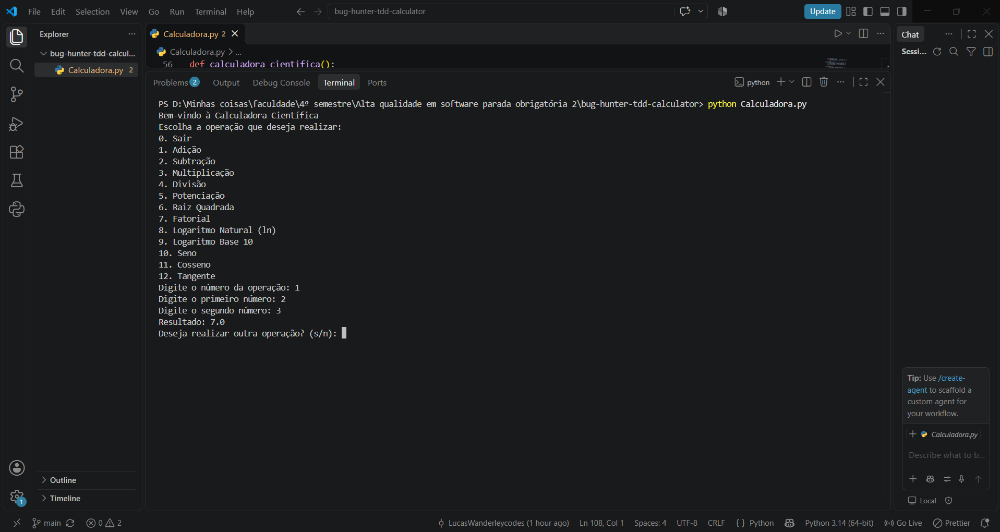
- **Severidade:** Alta
- **Impacto:** a operação mais básica devolve resultado errado.
- **Possível solução:** `return x + y`
- **Status:** Não resolvido

## BUG-02 - Divisão por zero não tratada

- **Localização:** `Calculadora.py`, função `divisao`, linha 13 (`return x / y`)
- **Descrição:** não há verificação de `y == 0`. O programa lança exceção e encerra.
- **Contexto:** Python 3.14.3, Windows.
- **Passos para reproduzir:**
  1. Rodar `python Calculadora.py`
  2. Digitar `4` (Divisão)
  3. Primeiro número: `10`; segundo número: `0`
- **Consistência:** ocorre sempre.
- **Resultado esperado:** mensagem de erro informando que não é possível dividir por zero, sem encerrar o programa.
- **Resultado obtido:** `ZeroDivisionError: division by zero` e o programa fecha.
- **Evidência:** 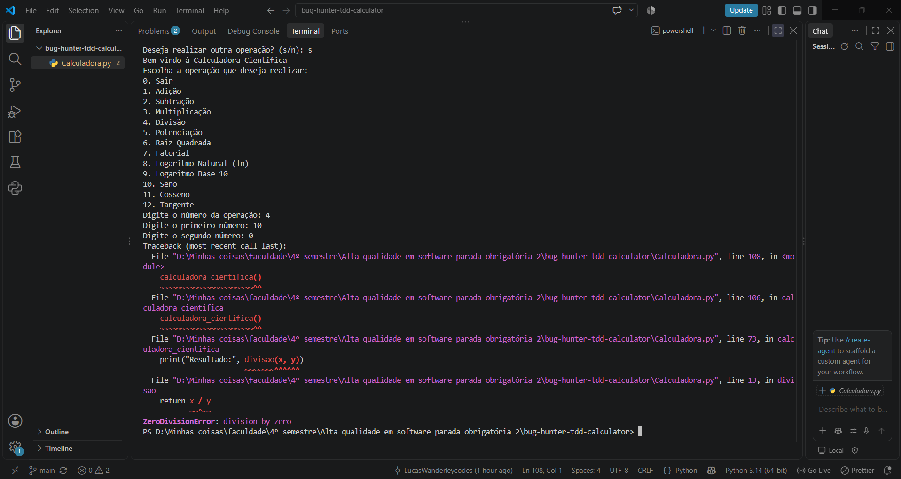
- **Log de erro:** `ZeroDivisionError: division by zero` (linha 13, em `divisao`)
- **Severidade:** Alta
- **Impacto:** o usuário perde a sessão por uma entrada comum.
- **Possível solução:** retornar mensagem de erro quando `y == 0`, como já é feito na raiz quadrada.
- **Status:** Não resolvido

## BUG-03 - Fatorial sempre devolve 0

- **Localização:** `Calculadora.py`, função `fatorial`, linha 25 (`for i in range(x+1)`)
- **Descrição:** `range(x+1)` começa em 0, então o primeiro `fat *= i` multiplica por 0 e o resultado fica sempre 0.
- **Contexto:** Python 3.14.3, Windows.
- **Passos para reproduzir:**
  1. Rodar `python Calculadora.py`
  2. Digitar `7` (Fatorial)
  3. Número: `5`
- **Consistência:** ocorre sempre.
- **Resultado esperado:** `120`
- **Resultado obtido:** `0`
- **Evidência:** 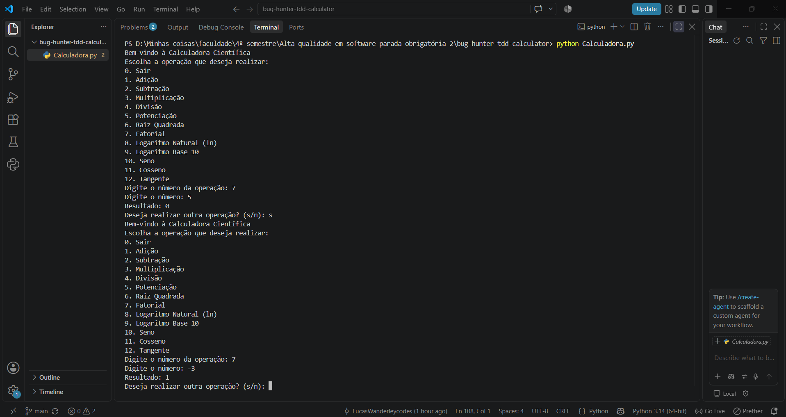
- **Severidade:** Alta
- **Impacto:** a operação nunca devolve resultado correto.
- **Possível solução:** `range(1, x+1)`
- **Status:** Resolvido em 07/11/2026

## BUG-04 - Fatorial sem validação de número negativo

- **Localização:** `Calculadora.py`, função `fatorial`, linhas 23 a 27
- **Descrição:** a função não valida a entrada. Para números negativos, o laço não executa e a função devolve 1, mas o fatorial de número negativo não existe.
- **Contexto:** Python 3.14.3, Windows.
- **Passos para reproduzir:**
  1. Rodar `python Calculadora.py`
  2. Digitar `7` (Fatorial)
  3. Número: `-3`
- **Consistência:** ocorre sempre.
- **Resultado esperado:** mensagem de erro informando que o fatorial não é definido para negativos.
- **Resultado obtido:** `Resultado: 1`
- **Evidência:** 
- **Severidade:** Média
- **Impacto:** resultado matemático incorreto, sem aviso ao usuário.
- **Possível solução:** retornar mensagem de erro quando `x < 0`.
- **Status:** Não resolvido

## BUG-05 - Logaritmo natural usa função inexistente

- **Localização:** `Calculadora.py`, função `logaritmo_natural`, linha 32 (`return np.ln(x)`)
- **Descrição:** o numpy não possui `np.ln`. A função correta é `np.log`.
- **Contexto:** Python 3.14.3, numpy 2.4.6.
- **Passos para reproduzir:**
  1. Rodar `python Calculadora.py`
  2. Digitar `8` (Logaritmo Natural)
  3. Número: `10`
- **Consistência:** ocorre sempre para números positivos.
- **Resultado esperado:** aproximadamente `2.302585`
- **Resultado obtido:** o programa fecha com erro.
- **Evidência:** 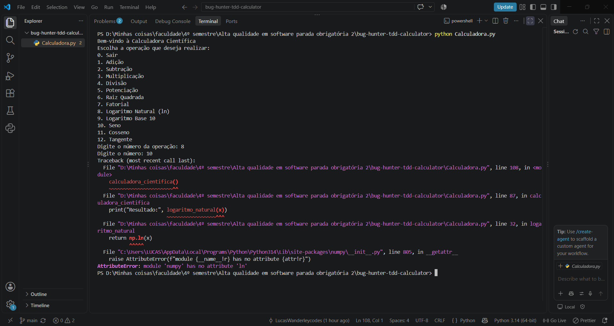
- **Log de erro:** `AttributeError: module 'numpy' has no attribute 'ln'`
- **Severidade:** Alta
- **Impacto:** a operação não funciona para nenhuma entrada válida.
- **Possível solução:** `return np.log(x)`
- **Status:** Não resolvido

## BUG-06 - Logaritmo base 10 usa a função errada

- **Localização:** `Calculadora.py`, função `logaritmo_base10`, linha 37 (`return np.log(x)`)
- **Descrição:** `np.log` calcula o logaritmo natural, não o de base 10.
- **Contexto:** Python 3.14.3, numpy 2.4.6.
- **Passos para reproduzir:**
  1. Rodar `python Calculadora.py`
  2. Digitar `9` (Logaritmo Base 10)
  3. Número: `100`
- **Consistência:** ocorre sempre.
- **Resultado esperado:** `2.0`
- **Resultado obtido:** `4.605170185988092`
- **Evidência:** 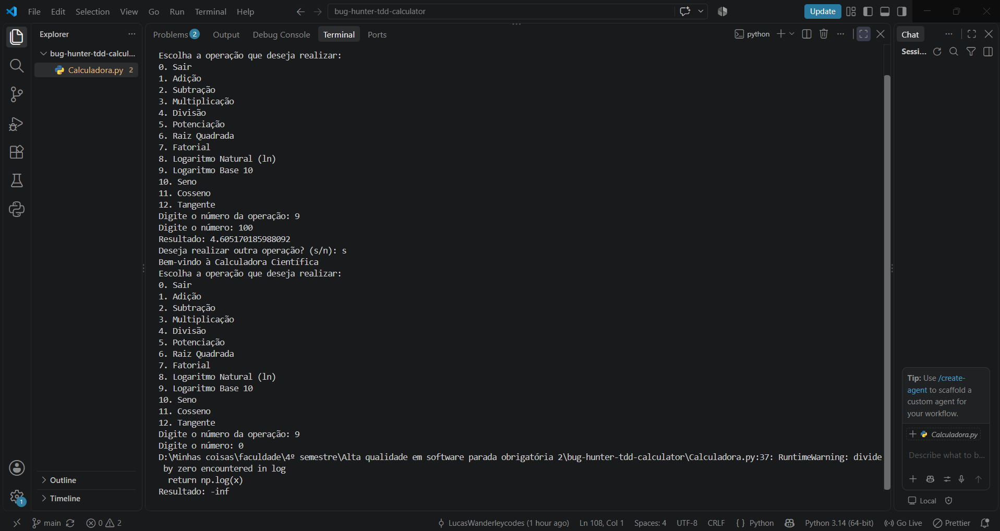
- **Severidade:** Alta
- **Impacto:** a operação devolve valor incorreto para todas as entradas.
- **Possível solução:** `return np.log10(x)`
- **Status:** Não resolvido

## BUG-07 - Logaritmo base 10 aceita o valor 0

- **Localização:** `Calculadora.py`, função `logaritmo_base10`, linha 35 (`if x < 0:`)
- **Descrição:** a validação usa `x < 0`, mas o logaritmo só é definido para números positivos. O valor 0 passa pela validação. A mensagem de erro diz "não positivo", o que mostra a intenção de bloquear 0 também. O logaritmo natural usa corretamente `x <= 0`.
- **Contexto:** Python 3.14.3, numpy 2.4.6.
- **Passos para reproduzir:**
  1. Rodar `python Calculadora.py`
  2. Digitar `9` (Logaritmo Base 10)
  3. Número: `0`
- **Consistência:** ocorre sempre.
- **Resultado esperado:** `Erro: Logaritmo de número não positivo`
- **Resultado obtido:** `Resultado: -inf`, com `RuntimeWarning: divide by zero encountered in log`
- **Evidência:** 
- **Severidade:** Média
- **Impacto:** valor matemático inválido exibido como resultado.
- **Possível solução:** trocar a condição para `x <= 0`.
- **Status:** Não resolvido

## BUG-08 - Seno listado no menu, mas não implementado

- **Localização:** `Calculadora.py`, função `menu` (opção 10) e função `calculadora_cientifica`
- **Descrição:** o menu oferece "10. Seno", mas não existe função de seno nem tratamento da opção 10.
- **Contexto:** Python 3.14.3, Windows.
- **Passos para reproduzir:**
  1. Rodar `python Calculadora.py`
  2. Digitar `10`
- **Consistência:** ocorre sempre.
- **Resultado esperado:** pedir o ângulo e mostrar o seno.
- **Resultado obtido:** `Operação inválida. Tente novamente.`
- **Evidência:** 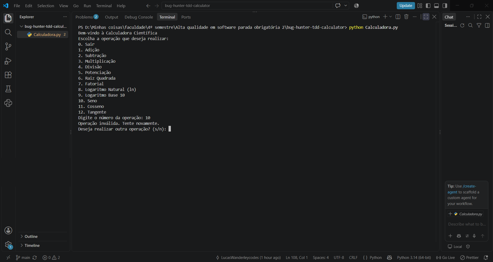
- **Severidade:** Média
- **Impacto:** funcionalidade anunciada ao usuário não existe.
- **Possível solução:** implementar a função `seno` e adicionar a opção `10` ao fluxo.
- **Status:** Não resolvido

## BUG-09 - Cosseno chama função inexistente

- **Localização:** `Calculadora.py`, função `calculadora_cientifica`, linha 95 (`cosseno(x)`)
- **Descrição:** a função `cosseno` não está definida em nenhum lugar do arquivo. O VS Code também sinaliza o problema (Pylance: `reportUndefinedVariable`).
- **Contexto:** Python 3.14.3, Windows.
- **Passos para reproduzir:**
  1. Rodar `python Calculadora.py`
  2. Digitar `11` (Cosseno)
  3. Ângulo: `60`
- **Consistência:** ocorre sempre.
- **Resultado esperado:** aproximadamente `0.5`
- **Resultado obtido:** o programa fecha com erro.
- **Evidência:** 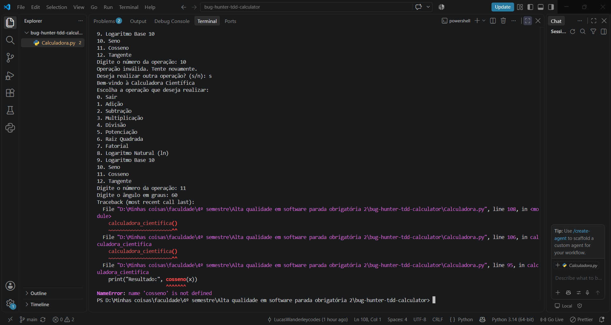
- **Log de erro:** `NameError: name 'cosseno' is not defined`
- **Severidade:** Alta
- **Impacto:** a operação está no menu, mas derruba o programa.
- **Possível solução:** implementar `cosseno` convertendo graus para radianos (`np.cos(np.radians(x))`).
- **Status:** Não resolvido

## BUG-10 - Tangente chama função inexistente

- **Localização:** `Calculadora.py`, função `calculadora_cientifica`, linha 99 (`tangente(x, radianos=False)`)
- **Descrição:** a função `tangente` não está definida. A chamada ainda usa o parâmetro `radianos=False`, que também não existe em lugar nenhum. O VS Code sinaliza o problema.
- **Contexto:** Python 3.14.3, Windows.
- **Passos para reproduzir:**
  1. Rodar `python Calculadora.py`
  2. Digitar `12` (Tangente)
  3. Ângulo: `45`
- **Consistência:** ocorre sempre.
- **Resultado esperado:** aproximadamente `1.0`
- **Resultado obtido:** o programa fecha com erro.
- **Evidência:** 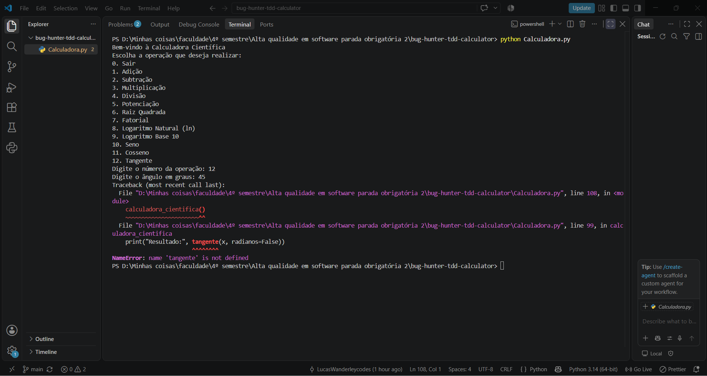
- **Log de erro:** `NameError: name 'tangente' is not defined`
- **Severidade:** Alta
- **Impacto:** a operação está no menu, mas derruba o programa.
- **Possível solução:** implementar `tangente` com o parâmetro `radianos` ou ajustar a chamada.
- **Status:** Não resolvido

## BUG-11 - Menu executa ao importar o arquivo

- **Localização:** `Calculadora.py`, última linha (108): `calculadora_cientifica()`
- **Descrição:** a chamada fica no nível do módulo, sem `if __name__ == "__main__":`. Ao importar o arquivo (por exemplo, em um teste automatizado), o menu abre e espera entrada do teclado.
- **Contexto:** Python 3.14.3; afeta o uso do pytest.
- **Passos para reproduzir:**
  1. Em um terminal, rodar `python -c "import Calculadora"`
- **Consistência:** ocorre sempre.
- **Resultado esperado:** apenas carregar as funções, sem executar o menu.
- **Resultado obtido:** o menu aparece e o programa aguarda digitação.
- **Evidência:** observação direta no código (linha 108).
- **Severidade:** Média
- **Impacto:** impede testar as funções de forma automatizada.
- **Possível solução:** proteger com `if __name__ == "__main__":`.
- **Status:** Resolvido em 06/11/2026 (corrigido como pré-requisito para os testes automatizados)

---

## Correção do BUG-03 com TDD

- **Bug corrigido:** BUG-03 - Fatorial sempre devolve 0
- **Data:** 07/11/2026
- **O que foi alterado:** na função `fatorial`, o laço `for i in range(x+1)` passou a ser `for i in range(1, x+1)`.
- **Por que foi alterado:** o laço começava em 0, então `fat *= 0` zerava o resultado em toda chamada. Começando em 1, o produto é calculado corretamente.
- **Como isso resolve o bug:** `fatorial(5)` passa a devolver `120`, em vez de `0`.

### Preparação

Antes dos testes, o BUG-11 foi corrigido: a chamada `calculadora_cientifica()` foi protegida com `if __name__ == "__main__":`, para que o pytest consiga importar o arquivo sem abrir o menu. Commit: `refactor: protege execucao do menu com __main__`.

### Ciclo TDD

1. **Red:** foi escrito o teste `test_fatorial_de_5` (`assert fatorial(5) == 120`), que falhou com `assert 0 == 120`. Commit: `test: adiciona teste que falha para BUG-03 (fatorial)`.

   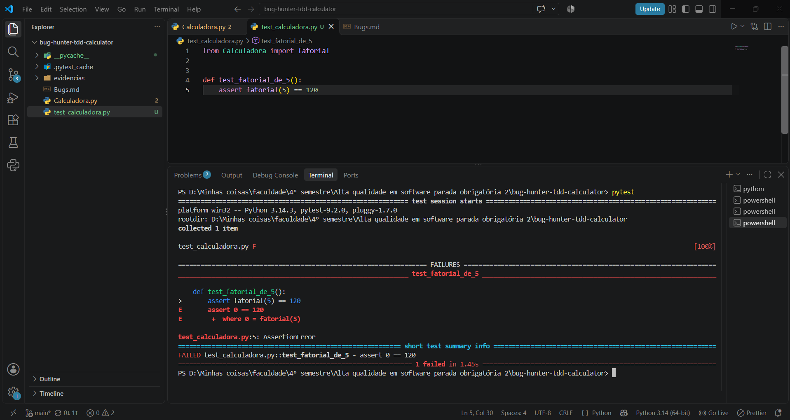

2. **Green:** correção mínima no laço (`range(1, x+1)`). O teste passou. Commit: `fix: corrige fatorial para iniciar o laco em 1 (BUG-03)`.

   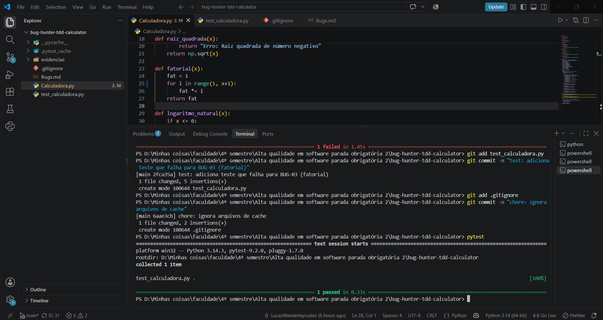

3. **Refactor:** adição de docstring à função `fatorial`, sem alterar o comportamento. Commit: `refactor: adiciona docstring ao fatorial`.

### Verificação final

Foram adicionados testes de regressão (`fatorial(0)`, `fatorial(1)`, subtração, multiplicação e raiz quadrada, com valor válido e negativo). Todos os 7 testes passam, então a correção não introduziu novos bugs. Commit: `test: adiciona testes de regressao para fatorial, subtracao, multiplicacao e raiz`.

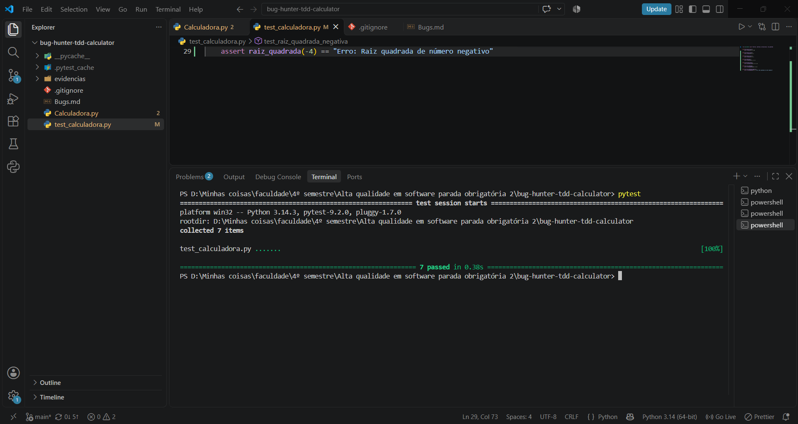

### Observação

O BUG-04 (fatorial de número negativo) continua aberto. Ele não foi tratado nesta correção para manter a mudança mínima.